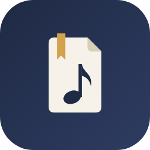
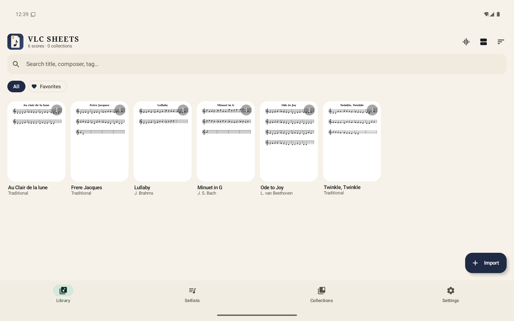
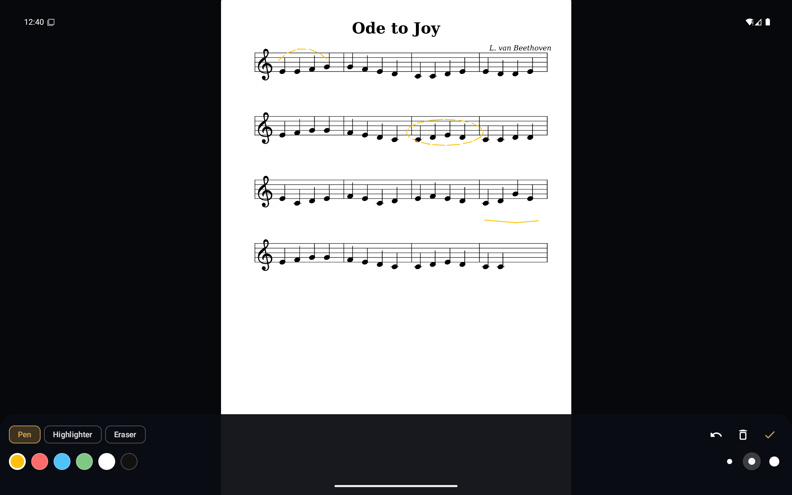
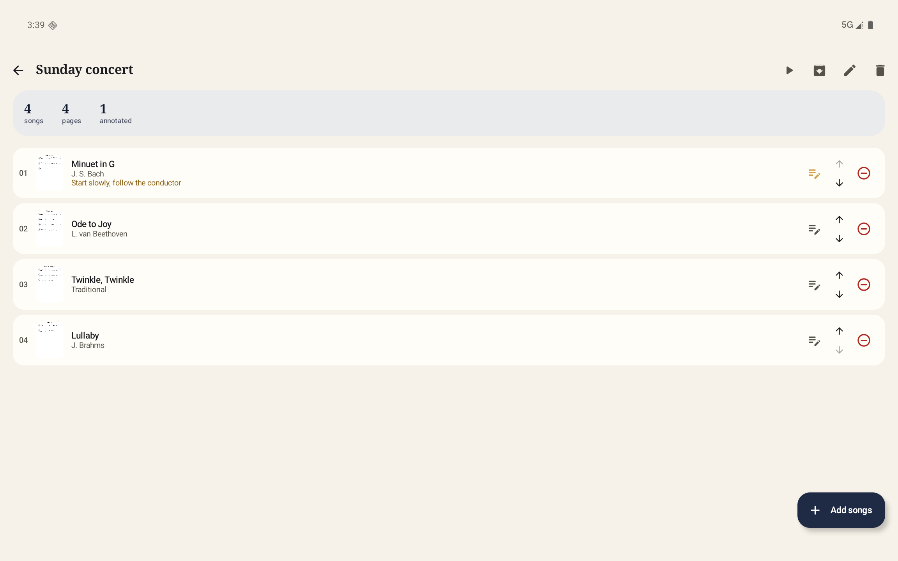
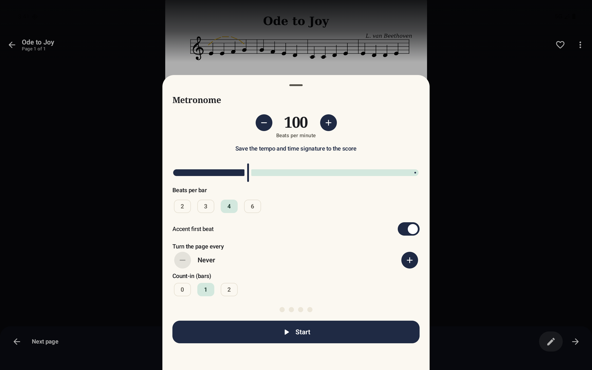
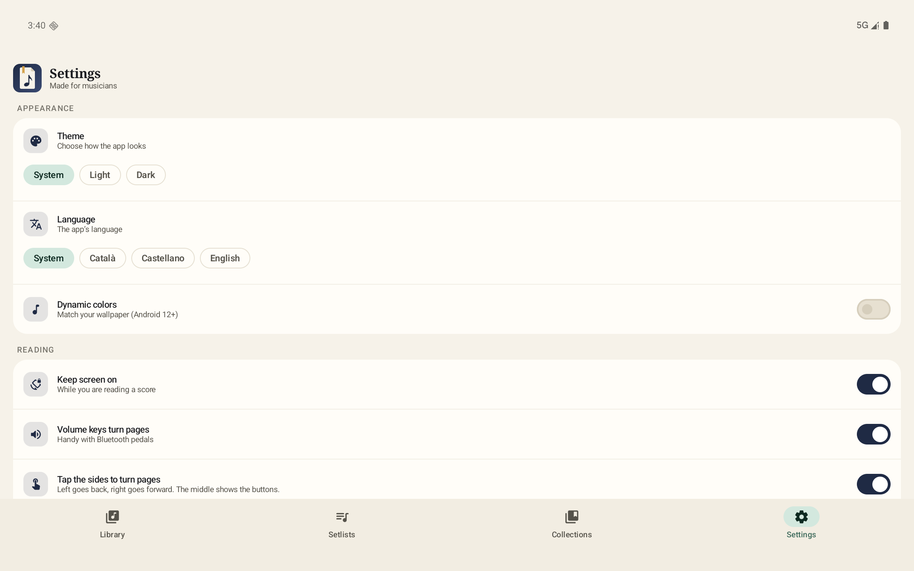

# VLC Sheets

[English](README.md) · **Català** · [Español](README.es.md)

La teva música, sempre a punt: un lector de partitures per a Android pensat per tocar en directe.

Ràpid, fosc quan cal i totalment fora de línia. Importa PDF o imatges, organitza la biblioteca, anota sobre el paper, crea llistes de concert i passa pàgina amb pedals Bluetooth o tecles de volum. Fet amb Kotlin, Jetpack Compose i Material 3.

  
  
  
  
  

<em>Captures, amb partitures de mostra fetes per a aquest projecte.</em>

## Instal·lar

Baixa l'APK de [Releases](../../releases) i obre'l a la tauleta. El primer cop, Android demana permís per instal·lar apps des del navegador.

## Funcions

- **Biblioteca:** importa PDF, imatges, text/ChordPro i fitxers `.vlcs`; cerca, ordena, filtra i col·leccions.
- **Lectura:** visor a pantalla completa amb zoom, dues pàgines una al costat de l'altra, mitges pàgines i retall de marges.
- **Passar pàgina:** tocant, amb botons, teclat, pedal Bluetooth o tecles de volum.
- **Àudio per partitura:** reprodueix pistes mentre llegeixes, més lent sense canviar el to, amb bucle i marques per passar pàgina.
- **Anotacions:** ploma i marcador amb el llapis òptic, goma i lletra a mà convertida en text.
- **Llistes de concert:** reordena partitures, una nota per peça i la durada total.
- **Metrònom i afinador:** inclosos, sense internet.
- **Còpia i exportació:** còpia completa en ZIP i exportació a PDF amb les anotacions dibuixades.
- **Temes i idiomes:** clar, fosc o automàtic; català, castellà i anglès.

Totes les funcions al detall a [docs/features.ca.md](docs/features.ca.md).

## Bo de saber

- L'APK de la v1.0.0 és una versió de proves (debug), no una versió de producció.
- Sense xarxa, sense comptes, sense telemetria: l'app no té el permís d'internet.
- L'únic permís és el del micròfon, per a l'afinador. Es demana el primer cop que l'obres i el so s'analitza a la tauleta, sense guardar-lo ni enviar-lo.
- Els fitxers importats es copien a l'espai privat de l'app i només surten del dispositiu quan exportes un PDF, un `.vlcs` o una còpia de seguretat.

## Estructura del projecte

Carpetes

| Carpeta | Què fa |
| --- | --- |
| `app/src/main/java/com/vlcsheets/app/data` | Biblioteca, importació, còpia, ChordPro, lletra a mà, ajustos |
| `app/src/main/java/com/vlcsheets/app/media` | Renderitzat de PDF, àudio, metrònom, afinador, exportació a PDF |
| `app/src/main/java/com/vlcsheets/app/ui` | Pantalles Compose, tema i components |
| `app/src/test` | Proves unitàries |
| `docs/` | Guies al detall i la icona de l'app |

L'arbre complet de fitxers i com compilar-la a [docs/development.ca.md](docs/development.ca.md).

## Dades i llicències

- Codi: [MIT](LICENSE).

## Versió

Actual: **1.0.0**. Cada versió és a [Releases](../../releases).

---

Developed by [Vlarac](https://github.com/Vlarac03)
