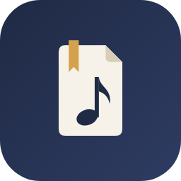
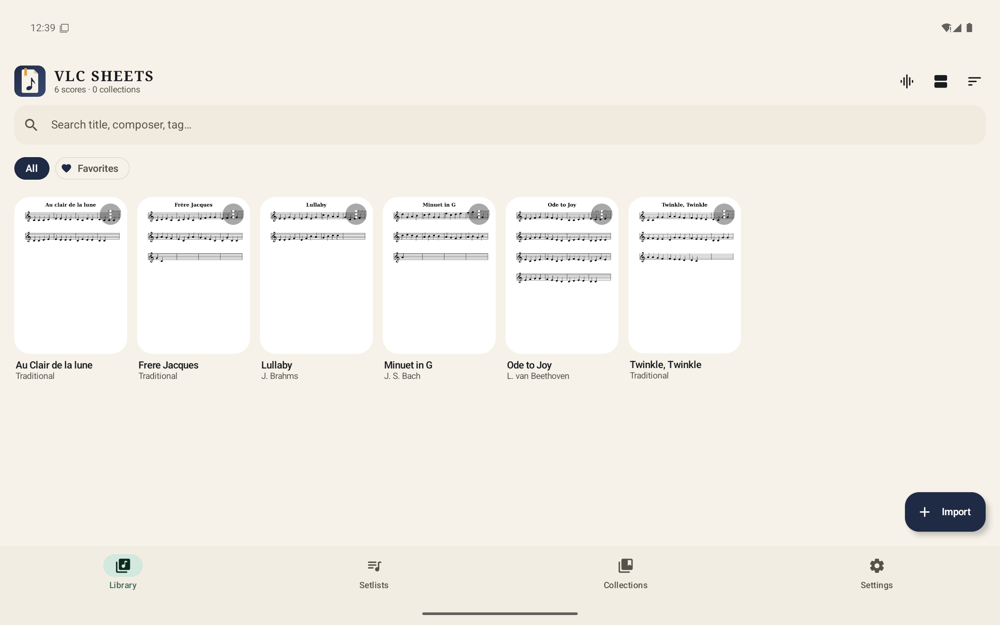
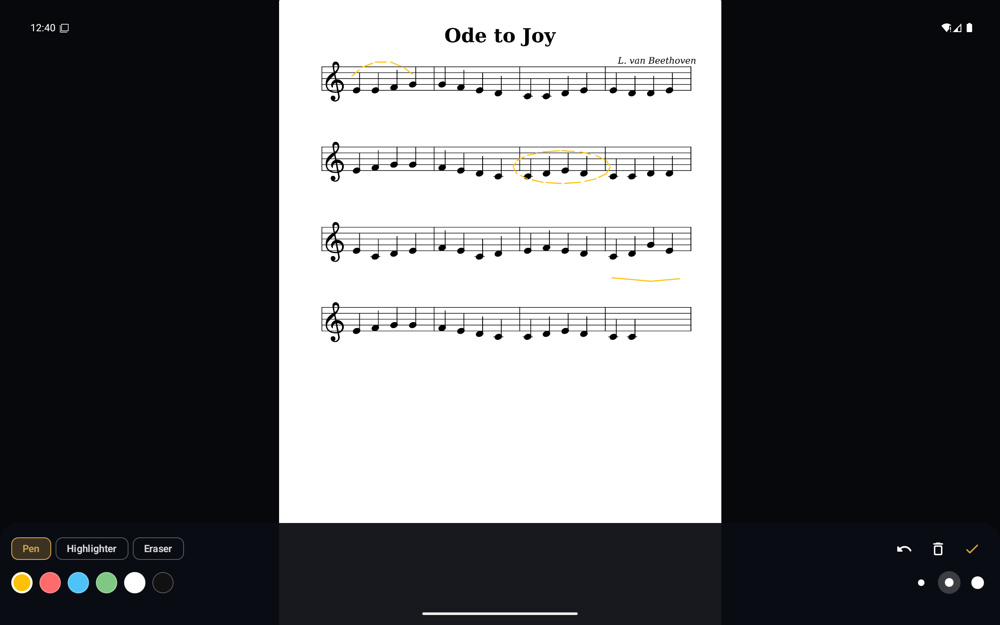
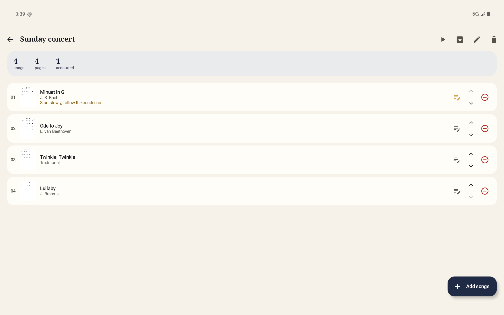
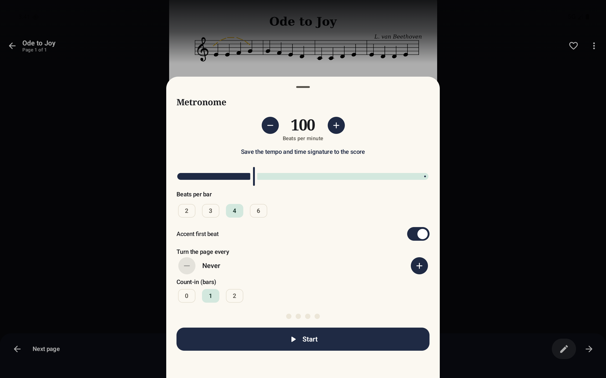
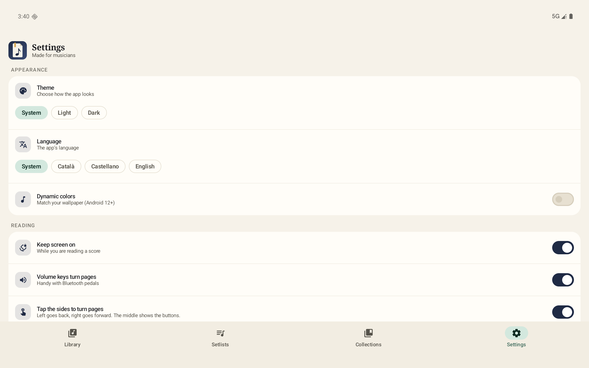

# VLC Sheets

[English](README.md) · [Català](README.ca.md) · **Español**

Tu música, siempre a punto: un lector de partituras para Android pensado para tocar en directo.

Rápido, oscuro cuando hace falta y totalmente sin conexión. Importa PDF o imágenes, organiza la biblioteca, anota sobre el papel, crea listas de concierto y pasa página con pedales Bluetooth o teclas de volumen. Hecho con Kotlin, Jetpack Compose y Material 3.

  
  
  
  
  

_Capturas, con partituras de muestra hechas para este proyecto._

## Instalar

Descarga el APK de [Releases](../../releases) y ábrelo en la tableta. La primera vez, Android pide permiso para instalar apps desde el navegador.

## Funciones

- **Biblioteca:** importa PDF, imágenes, texto/ChordPro y archivos `.vlcs`; busca, ordena, filtra y colecciones.
- **Lectura:** visor a pantalla completa con zoom, dos páginas una junto a la otra, medias páginas y recorte de márgenes.
- **Pasar página:** tocando, con botones, teclado, pedal Bluetooth o teclas de volumen.
- **Audio por partitura:** reproduce pistas mientras lees, más lento sin cambiar el tono, con bucle y marcas para pasar página.
- **Anotaciones:** pluma y marcador con el lápiz óptico, goma y letra a mano convertida en texto.
- **Listas de concierto:** reordena partituras, una nota por pieza y la duración total.
- **Metrónomo y afinador:** incluidos, sin internet.
- **Copia y exportación:** copia completa en ZIP y exportación a PDF con las anotaciones dibujadas.
- **Temas e idiomas:** claro, oscuro o automático; catalán, castellano e inglés.

Todas las funciones al detalle en [docs/features.es.md](docs/features.es.md).

## Conviene saber

- El APK de la v1.0.0 es una versión de pruebas (debug), no una versión de producción.
- Sin red, sin cuentas, sin telemetría: la app no tiene el permiso de internet.
- El único permiso es el del micrófono, para el afinador. Se pide la primera vez que lo abres y el sonido se analiza en la tableta, sin guardarlo ni enviarlo.
- Los archivos importados se copian al espacio privado de la app y solo salen del dispositivo cuando exportas un PDF, un `.vlcs` o una copia de seguridad.

## Estructura del proyecto

Carpetas

| Carpeta | Qué hace |
| --- | --- |
| `app/src/main/java/com/vlcsheets/app/data` | Biblioteca, importación, copia, ChordPro, letra a mano, ajustes |
| `app/src/main/java/com/vlcsheets/app/media` | Renderizado de PDF, audio, metrónomo, afinador, exportación a PDF |
| `app/src/main/java/com/vlcsheets/app/ui` | Pantallas Compose, tema y componentes |
| `app/src/test` | Pruebas unitarias |
| `docs/` | Guías al detalle y el icono de la app |

El árbol completo de archivos y cómo compilarla en [docs/development.es.md](docs/development.es.md).

## Datos y licencias

- Código: [MIT](LICENSE).

## Versión

Actual: **1.0.0**. Cada versión está en [Releases](../../releases).

---

Developed by [Vlarac](https://github.com/Vlarac03)
