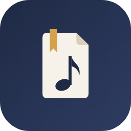

# VLC Sheets

**English** · [Català](README.ca.md) · [Español](README.es.md)

Your music, always ready: a sheet music reader for Android made for playing live.

Fast, dark when needed, and fully offline. Import PDFs or images, organise your library, write on the page, build setlists and turn pages with Bluetooth pedals or the volume keys. Built with Kotlin, Jetpack Compose and Material 3.

## Install

Download the APK from [Releases](../../releases) and open it on your tablet. The first time, Android asks for permission to install apps from your browser.

## Features

- **Library:** import PDFs, images, text/ChordPro and `.vlcs` files; search, sort, filter and collections.
- **Reading:** full-screen viewer with zoom, two pages side by side, half-page turns and margin cropping.
- **Page turning:** by tapping, buttons, keyboard, Bluetooth pedal or volume keys.
- **Audio per score:** play tracks while you read, slower without changing the pitch, with loops and page-turn marks.
- **Annotations:** pen and highlighter drawn with the stylus, eraser and handwriting to text.
- **Setlists:** reorder scores, a note per piece and the total duration.
- **Metronome and tuner:** built in, no internet needed.
- **Backup and export:** full ZIP backup and PDF export with the annotations drawn in.
- **Themes and languages:** light, dark or automatic; Catalan, Spanish and English.

Every feature in detail in [docs/features.md](docs/features.md).

## Good to know

- The v1.0.0 APK is a test (debug) build, not a release build.
- No network, no accounts, no telemetry: the app has no internet permission.
- The only permission is the microphone, for the tuner. It is asked the first time you open it, and the sound is analysed on the tablet, never stored or sent.
- Imported files are copied into the app's private storage and only leave the device when you export a PDF, a `.vlcs` file or a backup.

## Project structure

Folders

| Folder | What it does |
| --- | --- |
| `app/src/main/java/com/vlcsheets/app/data` | Library, import, backup, ChordPro, handwriting, settings |
| `app/src/main/java/com/vlcsheets/app/media` | PDF rendering, audio, metronome, tuner, PDF export |
| `app/src/main/java/com/vlcsheets/app/ui` | Compose screens, theme and components |
| `app/src/test` | Unit tests |
| `docs/` | Detailed guides and the app icon |

Full file tree and build instructions in [docs/development.md](docs/development.md).

## Data and licences

- Code: [MIT](LICENSE).

## Version

Current: **1.0.0**. Each version is in [Releases](../../releases).

---

Developed by [Vlarac](https://github.com/Vlarac03)
